# Path of Mercenaries (`PoM`) — Technical Specification

## 1. Overview & Core Product Pillars

**Path of Mercenaries (`PoM`)** is a browser-native build planner, Path of Building (PoB)-grade calculation engine, and gear/party simulator dedicated to **Path of Exile 1 Mercenaries** (Patch 3.29+ / 3.26+ Mercenary system). It brings desktop PoB's mechanical rigor, transparent calculation breakdowns, and high-density desktop workflow directly to the browser.

### Core Product Pillars
1. **PoB-Parity Calculation Fidelity (`packages/engine`):** Complete order-of-operations Hit, Impale, Damaging Ailment (Ignite, Bleed, Poison), Multi-Part Skill **Combined Full DPS**, and defensive **Max Hit Taken / EHP** math powered by a tagged `ModDB` with full source attribution.
2. **Authentic 4-Tab PoB Desktop Workspace:** A persistent PoB **Left Stat Sidebar** paired with top-level mode tabs (**`Items`** | **`Skills`** | **`Config`** | **`Calcs`**), supporting `Ctrl+C` / `Ctrl+V` in-game item pasting, live hover `+DPS` / `+EHP` slot comparison diffs, `+DPS`-sorted Support Gem selection, parameterized Player Link/Aurabot inputs, and clickable calculation breakdown tables.
3. **Mercenary-Specific Mechanics:** Native support for all **36 Mercenary archetypes** (Standard & Infamous), Mercenary Level (`1–85`) to Internal Skill Level (`1–40`) scaling curves, hidden Mercenary baseline stats (`+35%` base elemental resistances at level 80+), custom effectiveness overrides (e.g., *Kinetic Blast of Clustering* at `235%`), and signature Mercenary/Party synergies (*Flame Link*, *Destructive Link*, *Pyroclast Mine of Sabotage*, *Doryani's Prototype*, *Perquil's Toe*, *Rakiata's Dance*).
4. **Zero-Friction Sharing + Cloud Persistence:** Instant stateless URL share codes and PoB-compatible **Party** XML export, complemented by centralized Google SSO and personal/shared cloud build libraries via **Dunhas Auth Hub (`https://auth.dunhas.com` / Cloudflare D1 `general-db`)**.

---

## 2. Monorepo & Strict Vertical-Slicing Architecture (`<300` LOC Mandate)

### Architectural Mandates
Every package and application in the monorepo must adhere to strict modularity rules to keep files readable, testable, and context-friendly:
* **Vertical Slicing (Domain-Driven Design):** Code is grouped by feature or engine domain—never split across global `controllers/`, `components/`, `utils/`, or `services/` folders. Each domain folder owns its types, math/state logic, UI, and tests.
* **Strict File Size Limit (`<300` LOC):** No single source file (`.ts`, `.tsx`, `.css`) may exceed **300 lines of code**. Larger modules must be decomposed into cohesive sub-modules inside the same slice.
* **Colocation:** In `apps/web`, a feature's UI components, state hooks, and CSS Module (`.module.css`) live side-by-side inside that feature's folder.
* **Hyper-Descriptive Naming:** Avoid generic names like `utils.ts` or `helpers.ts`; use explicit filenames such as `conversion_dag_resolver.ts` or `doryanis_prototype_handler.ts`.
* **Localized Context Maps:** Each major feature slice and engine module maintains a concise `README.md` documenting domain invariants and data flow.

### Repository Structure
```text
path-of-mercenaries/
├── apps/
│   ├── web/                                   # React + TypeScript + Vite SPA (Cloudflare Pages)
│   │   └── src/
│   │       ├── features/
│   │       │   ├── left-stat-sidebar/         # Persistent PoB sidebar: Archetype, Skill selector, DPS/Defences summary
│   │       │   ├── items-paperdoll-inspector/ # 10-slot paperdoll, live hover diff tooltips, raw/roll editor, Uniques DB
│   │       │   ├── skills-support-planner/    # Primary/Secondary/Utility groups, +DPS support sorter, Full DPS parts
│   │       │   ├── party-enemy-config/        # Flame/Destructive Link, Aurabot effect, Charges, Curses, Boss presets
│   │       │   ├── calcs-breakdown-matrix/    # PoB Calcs tab: per-type damage matrix & source-attributed bucket tables
│   │       │   └── build-share-auth/          # Dunhas Auth Hub SSO, cloud saves, URL LZ-hash & PoB Party XML export
│   │       └── styles/                        # tokens.css, primitives.css, poe-tooltip.css
│   └── worker/                                # Hono edge API (Cloudflare Workers)
│       └── src/
│           └── features/
│               ├── ggg-mercenary-importer/    # GGG OAuth/profile API proxy & KV rate-limit cache
│               └── catalog-bundle-server/     # Immutable patch-versioned JSON catalog endpoints
├── packages/
│   ├── engine/                                # Pure, zero-DOM TypeScript PoB calculation engine
│   │   └── src/
│   │       ├── mod-db/                        # Modifier AST, bitmask keyword/damage tags, source attribution
│   │       ├── catalog-types/                 # Shared Archetype, Skill, Support, Item, and Config schemas
│   │       ├── item-parser/                   # PoE Ctrl+C clipboard parser & local weapon DPS/APS/Crit calculator
│   │       ├── unique-handlers/               # Dedicated rule hooks for build-around Uniques
│   │       ├── damage-pipeline/               # 10-stage Hit, Conversion, Crit, Lucky, Mitigation, Ailment & Impale math
│   │       ├── defence-pipeline/              # Pools, Res, Phys-Taken-As, Armour curve, Suppression, Max Hit & EHP
│   │       ├── support-optimizer/             # Candidate Support Gem marginal +DPS ranker
│   │       └── item-diff-calculator/          # Live slot replacement delta calculator (+Full DPS%, +EHP%, Res delta)
│   └── data-pipeline/                         # CLI scripts to ingest RePoE + PoEDB datamines & run parity fixtures
├── wrangler.toml                              # Cloudflare Workers & KV bindings
└── package.json                               # pnpm / npm workspaces configuration
```

---

## 3. Backend, Auth & Persistence (`auth.dunhas.com` + Stateless Codes)

`PoM` uses a **two-tier persistence strategy** so anonymous users can calculate and share builds instantaneously, while signed-in users get persistent cloud libraries and short shareable URLs without maintaining custom auth tables.

### Tier 1: Zero-Auth Stateless Sharing & PoB Interop (100% Client-Side)
1. **Compressed URL Hash (`#b=<lz-base64>`):** Serializes the compact `MercenaryBuildState` JSON (archetype ID, level, item clipboard/unique definitions, skill choices, config flags) using `lz-string` URI encoding. Fits entirely in a shareable link with zero server round-trips.
2. **PoB Party Tab XML Export / Import:** Generates zlib-compressed Base64 XML strings compatible with desktop Path of Building's **Party** tab (`<Party>` / `<Export>` blocks), allowing users to drop a configured `PoM` mercenary directly into their main character's desktop PoB to inspect combined party aura/DPS interactions.

### Tier 2: Centralized Google Auth & Cloud D1 Storage (`auth.dunhas.com`)
User authentication, personal build libraries, and public short-link snapshots use the centralized **Dunhas Auth & Storage Hub** (`https://auth.dunhas.com`) backed by Cloudflare D1 **`general-db`** (UUID: `e5a10825-7799-438a-926d-1b296afcccdd`).

* **Client SDK Integration:**
  ```ts
  import { createClient } from 'https://auth.dunhas.com/sdk.mjs';

  export const dunhasHub = createClient({
    appId: 'path-of-mercenaries',
  });
  ```
* **Authentication Flow:** Supports both 1-click Google OAuth redirect (`dunhasHub.loginWithRedirect()`) and inline Google Sign-In (`dunhasHub.renderGoogleButton(...)`).
* **Personal Cloud Library (`hub.db`):**
  * **Collection:** `'builds'` (isolated per `user_id` in `general-db`).
  * **Document Key:** `<build_uuid>`
  * **Payload Schema:**
    ```ts
    interface CloudSavedBuild {
      id: string;
      name: string;
      archetypeId: string;
      mercLevel: number;
      headlineFullDps: number;
      headlineEhp: number;
      tags: string[];             // e.g., ["Kineticist", "Doryani", "Aurabot"]
      buildState: MercenaryBuildState;
      updatedAt: string;
    }
    ```
* **Public Short Build Slugs (`hub.shared`):**
  * **Collection:** `'shared_builds'` (`user_id = '__SHARED__'`, publicly readable without login, writable by authenticated users).
  * **Document Key:** Short base62 slug (e.g., `k9x4m2`) routed in the SPA as `/b/:slug`.
  * **Payload Schema:** Immutable or owner-versioned `MercenaryBuildState` + `authorDisplayName` + `createdAt`.

### Edge Compute & Game Data Caching (`apps/worker` + Cloudflare KV)
Because game definitions are read-heavy and patched deterministically per PoE league, `apps/worker` serves two lightweight responsibilities:
1. **GGG Character & Mercenary Importer (`GET /api/import/ggg/:account/:character`):** Proxies requests to GGG's Patch 3.29.3b+ `active_mercenary_index` endpoint, normalizes equipped items and rolled skills into `PoM` schema objects, and caches responses in **Cloudflare KV** (`TTL: 300s`) for GGG API rate-limit protection.
2. **Immutable Catalog Bundles:** Serves patch-versioned, gzip/brotli-cached JSON bundles compiled by `packages/data-pipeline` (`archetypes.v1.json`, `merc_skills.v1.json`, `support_gems.v1.json`, `base_items.v1.json`, `uniques.v1.json`) to both the client SPA (cached in IndexedDB/HTTP cache) and Worker validators.

---

## 4. Data Sources & Mercenary Domain Model

### Authoritative Data Sources
1. **PoEDB (`poedb.tw/us/Mercenaries`) & GGPK Datamines:**
   * All **36 Mercenary Archetypes** (18 Standard + 18 Infamous variants), base attribute profiles (`STR`, `DEX`, `INT`, `STR_DEX`, `STR_INT`, `DEX_INT`, `STR_DEX_INT`), permitted weapon/offhand classes, and **Primary / Secondary / Utility** skill pools.
   * Mercenary Level (`1–85`) $\to$ Internal Skill Level (`1–40`) mapping tables and custom effectiveness overrides (e.g., *Kinetic Blast of Clustering* `235%` effectiveness, *Kinetic Bolt of Fragmentation*, etc.).
2. **RePoE (`repoe-fork.github.io`):**
   * `base_items.json`, `mods.json`, `uniques.json`, `gems.json` for exact weapon base min/max physical damage, base APS, base crit chance, armour/evasion/ES base values, implicit mods, and support gem multipliers/tag requirements.
3. **Community Datamined PoB Templates (`pob.codes`):**
   * Golden validation fixtures verifying Mercenary hidden base accuracy, level-scaled base life, and hidden `+35%` elemental resistances at Mercenary level 80+.
4. **GGG Developer API (Patch 3.29.3b+):**
   * Live hired mercenary gear, socketed/rolled skills, and support links via `active_mercenary_index`.

### Core Domain TypeScript Interfaces (`packages/engine/src/catalog-types`)

```ts
export type DamageType = 'Physical' | 'Lightning' | 'Cold' | 'Fire' | 'Chaos';

export interface MercenaryLevelStatRow {
  level: number;
  baseLife: number;
  baseAccuracy: number;
  baseEvasion: number;
  baseStr: number;
  baseDex: number;
  baseInt: number;
  hiddenElemResPct: number;   // +35% at level 80+ (verified against PoB datamine fixtures)
  defaultSkillLevel: number;  // e.g., Merc Lv 82 -> Skill Lv 26; Merc Lv 84 -> Skill Lv 27
}

export interface MercenaryArchetype {
  id: string;                 // e.g., 'kineticist', 'infamous_kineticist'
  name: string;
  isInfamous: boolean;
  attributeAffinity: 'STR' | 'DEX' | 'INT' | 'STR_DEX' | 'STR_INT' | 'DEX_INT' | 'STR_DEX_INT';
  allowedMainHandClasses: string[];
  allowedOffHandClasses: string[];
  canDualWield: boolean;
  statsByLevel: Record<number, MercenaryLevelStatRow>;
  innateMods: string[];       // Archetype-specific hidden global damage/mitigation modifiers
  skillPool: {
    primary: string[];
    secondary: string[];
    utility: string[];
  };
}

export interface SkillPartDefinition {
  id: string;                 // e.g., 'primary_projectile', 'clustering_explosion'
  label: string;              // e.g., 'Projectile Hit', 'Clustering Area Explosion'
  defaultFullDpsCount: number;// e.g., 1 for projectile, 5 for explosion overlaps
  isSpell: boolean;
  isAttack: boolean;
  skillModFlags: number;      // Bitmask of ModFlags
  skillKeywordFlags: number;  // Bitmask of KeywordFlags
  damageEffectiveness: number;// e.g., 2.35 for 235%
  baseAttackTimeOverrideSec?: number;
  baseCastTimeSec?: number;
  attackSpeedMulti?: number;  // e.g., 1.15 for 115% of base attack speed
  baseCritChancePct?: number; // For spells or special attacks
  weaponDamageMultiplierPctByLevel: Record<number, number>; // Attack damage % of base
  baseAddedDamageByLevel: Record<number, Partial<Record<DamageType, [number, number]>>>;
  inherentConversion?: Partial<Record<DamageType, Partial<Record<DamageType, number>>>>;
  partMods: string[];         // Mod lines active only for this skill part
}

export interface MercenarySkillDefinition {
  id: string;
  name: string;
  category: 'PRIMARY' | 'SECONDARY' | 'UTILITY';
  tags: string[];             // ['Attack', 'Projectile', 'Wand', 'Area']
  maxSupports: number;        // Default 5 for Mercenaries
  parts: SkillPartDefinition[];
}

export interface SupportGemDefinition {
  id: string;
  name: string;
  requiredSkillTags: string[];// e.g., ['Attack', 'Projectile'] or ['Spell']
  excludedSkillTags?: string[];
  manaMultiplierPct: number;
  modsByLevel: Record<number, string[]>;
}
```

---

## 5. Core Calculation Architecture: `ModDB`, Tagging Bitmasks & Source Attribution

To achieve genuine PoB accuracy and transparency, **no stat or damage calculation may hardcode ad-hoc item additions outside the modifier database**. Every archetype trait, equipped item mod, skill property, support gem effect, party link, aura, curse, and config state compiles into structured `Mod` entries inside `packages/engine/src/mod-db`.

### Bitmask Flags & Modifier AST
```ts
export enum ModFlags {
  None       = 0,
  Attack     = 1 << 0,
  Spell      = 1 << 1,
  Melee      = 1 << 2,
  Projectile = 1 << 3,
  Area       = 1 << 4,
  Hit        = 1 << 5,
  Dot        = 1 << 6,
  Ailment    = 1 << 7,
  Wand       = 1 << 8,
  Bow        = 1 << 9,
  Sword      = 1 << 10,
  Axe        = 1 << 11,
  Mace       = 1 << 12,
  Staff      = 1 << 13,
  Claw       = 1 << 14,
  Dagger     = 1 << 15,
  DualWield  = 1 << 16,
  TwoHanded  = 1 << 17,
}

export enum KeywordFlags {
  None      = 0,
  Physical  = 1 << 0,
  Lightning = 1 << 1,
  Cold      = 1 << 2,
  Fire      = 1 << 3,
  Chaos     = 1 << 4,
  Elemental = (1 << 1) | (1 << 2) | (1 << 3),
  Crit      = 1 << 5,
  Impale    = 1 << 6,
  Bleed     = 1 << 7,
  Ignite    = 1 << 8,
  Poison    = 1 << 9,
  Aura      = 1 << 10,
  Curse     = 1 << 11,
}

export type ModType = 'BASE' | 'INC' | 'MORE' | 'OVERRIDE' | 'FLAG';

export interface ModSource {
  sourceType: 'Archetype' | 'Item' | 'Skill' | 'Support' | 'PartyLink' | 'PartyAura' | 'Config' | 'Enemy' | 'Custom';
  sourceId: string;           // e.g., 'slot:BodyArmour', 'support:AwakenedElementalDamageWithAttacks'
  sourceLabel: string;        // Human-readable name displayed in the Calcs tab
  rawLine: string;            // Original modifier line
}

export interface ModCondition {
  type: 'Condition' | 'StatThreshold' | 'PerStat' | 'SkillTag';
  varName: string;            // e.g., 'Onslaught', 'EnemyShocked', 'PowerCharges'
  negated?: boolean;
  min?: number;
  max?: number;
  divisor?: number;           // For "per X attribute / aura / power charge" scaling
}

export interface Mod {
  name: string;               // Canonical stat key, e.g., 'Damage', 'FireMin', 'Speed', 'CritChance'
  type: ModType;
  value: number | boolean;
  flags: number;              // Required ModFlags bitmask
  keywordFlags: number;       // Required KeywordFlags bitmask
  conditions?: ModCondition[];
  source: ModSource;
}
```

### `ModDB` Query API & Source Tabulation
`ModDB` exposes both fast scalar queries (used during candidate Support Gem ranking and live hover item diffing) and attributed tabulation queries (used by the **`Calcs`** tab):

```ts
export interface ModQuery {
  names: string[];            // e.g., ['Damage', 'PhysicalDamage', 'ElementalDamage']
  flags: number;              // Active skill + chunk ModFlags
  keywordFlags: number;       // Active skill + chunk KeywordFlags (including ancestral conversion tags!)
  context: EvalContext;       // Active combat/enemy conditions & stat counters (e.g., PowerCharges = 3)
}

export interface TabulatedModEntry {
  sourceLabel: string;
  sourceType: ModSource['sourceType'];
  rawLine: string;
  modType: ModType;
  resolvedValue: number;
}

export interface ModDB {
  addMod(mod: Mod): void;
  sum(type: 'BASE' | 'INC', query: ModQuery): number;
  more(query: ModQuery): number; // Product of (1 + val / 100), clamped >= 0
  override(name: string, query?: Partial<ModQuery>): number | undefined;
  flag(name: string, context: EvalContext): boolean;
  tabulate(type: ModType, query: ModQuery): TabulatedModEntry[];
}
```

> **Invariants:**
> * `INC` modifiers across all matching names (e.g., `Damage` + `ElementalDamage` + `FireDamage` + `ProjectileDamage`) sum into **one** additive multiplier: $1 + \frac{\sum \text{INC}}{100}$.
> * `MORE` modifiers multiply independently per `Mod` entry: $\prod \left(1 + \frac{v_i}{100}\right)$.
> * Dynamic `PerStat` scaling (e.g., *"1% increased Damage per 16 Intelligence"*, *"2% more Damage per Frenzy Charge"*, *"Adds 1 to 15 Lightning Damage per 200 Maximum Energy Shield"*) resolves during query evaluation using `EvalContext`.

---

## 6. 10-Stage PoB Damage Calculation Pipeline (`packages/engine/src/damage-pipeline`)

The damage engine evaluates each enabled `(Skill, SkillPart)` deterministically through 10 ordered stages, emitting both final metrics and an intermediate `CalcBreakdownSnapshot` consumed by the `Calcs` tab.

```mermaid
flowchart LR
  S1["1. Local Weapon & Base Skill"] --> S2["2. Added Damage × Effectiveness"]
  S2 --> S3["3. Conversion DAG & Gain as Extra"]
  S3 --> S4["4. Tagged INC / RED & MORE / LESS"]
  S4 --> S5["5. Crit, Brittle, Lucky & Multi-Hit"]
  S5 --> S6["6. Accuracy, Evasion & Action Rate"]
  S6 --> S7["7. Enemy Res, Pen & Doryani/Rakiata"]
  S7 --> S8["8. Enemy Armour, PDR & Taken Multi"]
  S8 --> S9["9. Impale & Ailments (Ignite/Bleed/Poison)"]
  S9 --> S10["10. Skill Parts & Combined Full DPS"]
```



### Stage 1: Local Weapon & Skill Base Damage
Weapon modifiers marked **local** (`LocalPhysicalDamage`, `LocalAddedPhysicalDamage`, `LocalFireDamage`, `LocalAttackSpeed`, `LocalCriticalStrikeChance`, `Quality`) modify the weapon item itself before global modifiers apply:

$$\text{LocalPhys}_{\min,\max} = \left(\text{BasePhys}_{\min,\max} + \sum \text{LocalAddedPhys}_{\min,\max}\right) \times \left(1 + \frac{\text{LocalIncPhys\%} + \text{Quality\%}}{100}\right)$$

$$\text{LocalEle}_{t,\min,\max} = \sum \text{LocalAddedEle}_{t,\min,\max}$$

$$\text{WeaponAPS} = \text{BaseAPS} \times \left(1 + \frac{\text{LocalIncAttackSpeed\%}}{100}\right), \qquad \text{WeaponCrit\%} = \text{BaseCrit\%} \times \left(1 + \frac{\text{LocalIncCrit\%}}{100}\right)$$

For **Attack** skills, Stage 1 scales weapon base damage by the skill part's Weapon Damage Multiplier ($M_{\text{weap}}$):

$$\text{SkillBase}_{t,\min,\max} = \text{WeaponLocal}_{t,\min,\max} \times M_{\text{weap}}$$

For **Spell** skills (or secondary explosion components that ignore weapon damage), $\text{SkillBase}_{t,\min,\max}$ is drawn directly from `baseAddedDamageByLevel[skillLevel][t]`.

### Stage 2: Global Flat Added Damage & Damage Effectiveness
All global flat added damage sources (Jewelry, Abyss Jewels, Support Gems, *Wrath*, *Anger*, *Smite*, *Pyroclast Mine of Sabotage*, *Flame Link*, *Ephemeral Edge*, *Crown of the Tyrant*) are summed per type $t$ and multiplied by the skill part's **Damage Effectiveness** ($E_{\text{dmg}}$):

$$\text{TotalBasePool}_{t,\min,\max} = \text{SkillBase}_{t,\min,\max} + \left(\sum \text{GlobalAdded}_{t,\min,\max} \times E_{\text{dmg}}\right)$$

**Parameterized Player Party Link & Aura Scaling:**
* **Flame Link:** Adds flat Fire damage scaled by Player Max Life ($L_{\text{player}}$) and Link Gem base values + Player Link Effect %:
  $$\text{FlameLinkFire}_{\min,\max} = \left(\text{GemBase}_{\min,\max} + c_{\text{life}} \times L_{\text{player}}\right) \times (1 + \text{LinkEffect\%})$$
  (At Gem Level 20, $c_{\text{life}} \approx 0.05$ max / $0.03$–$0.05$ interpolated curve from `gems.json`).
* **Player Auras & Mines:**
  $$\text{EffectiveAuraMod} = \text{BaseAuraMod} \times \left(1 + \frac{\text{GlobalPlayerAuraEffect\%} + \text{GenerosityEffect\%}}{100}\right)$$
  For *Pyroclast Mine of Sabotage*, flat fire damage equals $\text{PerMineFire}_{\min,\max} \times N_{\text{activeMines}} \times (1 + \text{AuraEffect\%})$.

### Stage 3: Directed Acyclic Conversion Chain & `"Gain as Extra"`
PoE enforces a strict one-way conversion order:

$$\text{Physical} \to \text{Lightning} \to \text{Cold} \to \text{Fire} \to \text{Chaos}$$

1. **Conversion Normalization:** At each source type $s$, if total outward conversion $\sum_{d > s} C_{s \to d} > 100\%$:
   * **Skill-inherent conversions** are preserved first up to $100\%$.
   * **Gear/Support conversions** fill remaining unallocated capacity $R = \max(0, 100\% - C_{\text{skill}})$, scaled proportionally:
     $$C'_{s \to d,\text{gear}} = C_{s \to d,\text{gear}} \times \frac{R}{\sum C_{\text{gear}}}$$
2. **Gain as Extra (`PhysAsExtraLightning`, `NonChaosAsExtraChaos`, etc.):** Applied at each step $s$ **before** damage leaves $s$, creating new chunks at destination type $d > s$.
3. **Ancestral Tag Inheritance (Critical PoB Rule):** Every generated damage chunk carries a bitmask `ancestralTypes` recording every type it passed through:
   $$\text{Chunk}: \text{Physical} \xrightarrow{50\%} \text{Lightning} \xrightarrow{40\%} \text{Cold} \implies \text{ancestralTypes} = (\text{Physical} \mid \text{Lightning} \mid \text{Cold})$$
   A chunk's Stage 4 `INC` and `MORE` queries match modifiers for **any** type in `ancestralTypes` without double-counting the same modifier twice on one chunk.

### Stage 4: Tagged `INC`/`RED` and `MORE`/`LESS` Scaling
For each distinct damage chunk $c$ (identified by `(currentType, ancestralTypes)`):

$$\text{ScaledChunk}_{c,\min,\max} = \text{ChunkBase}_{c,\min,\max} \times \max\left(0,\; 1 + \frac{\text{ModDB.sum('INC', query}_c)}{100}\right) \times \text{ModDB.more}(\text{query}_c)$$

Chunks sharing the same `currentType` are summed after scaling to produce the post-modifier pre-mitigation hit range $[D_{t,\min}, D_{t,\max}]$ per type $t$.

### Stage 5: Crit, Brittle, Lucky Rolls & Double/Triple Damage
1. **Lucky Damage Rolls** (e.g., *Perquil's Toe* `"Nearby Allies' Damage with Hits is Lucky"`, *Voices of the Storm*):
   * **Normal Roll:** $E_{\text{normal}}[D_t] = \frac{D_{t,\min} + D_{t,\max}}{2}$
   * **Lucky Roll (max of 2 uniform draws):**
     $$E_{\text{lucky}}[D_t] = \frac{D_{t,\min} + 2 D_{t,\max}}{3}$$
   * **Unlucky Roll:** $E_{\text{unlucky}}[D_t] = \frac{2 D_{t,\min} + D_{t,\max}}{3}$
2. **Effective Critical Strike Chance:**
   * **Base Crit Override:** If *Destructive Link* is active, $\text{BaseCrit} = \max(\text{WeaponCrit}, \text{PlayerMainHandCrit})$ (or exact Destructive Link override semantics per PoE patch).
   * **Flat Added Crit:** Add flat crit from *Brittle* (up to $+6.0\%$), *Increased Critical Strikes Support*, *Hatred Watcher's Eye*, *Assassin's Mark*:
     $$\text{CritRaw} = \left(\text{BaseCrit\%} + \text{FlatBaseCrit\%}\right) \times \left(1 + \frac{\text{IncCrit\%}}{100}\right) + \text{EnemyFlatCritTaken\%}$$
   * Clamp $P_{\text{crit}} = \text{clamp}(\text{CritRaw} / 100,\; 0,\; 1)$.
   * If **Crit is Lucky** (e.g., *Diamond Flask* or *Ungil's Harmony*/*Lucky Crit*):
     $$P_{\text{crit,lucky}} = 1 - (1 - P_{\text{crit}})^2$$
   * For **Attacks**, confirming a critical strike requires a second accuracy roll:
     $$P_{\text{crit,eff}} = P_{\text{crit,roll}} \times \text{HitChance}$$
     *(For Spells, $\text{HitChance} = 1.0$.)*
3. **Expected Crit & Double/Triple Damage Multipliers:**
   $$\text{CritMulti}_{\text{eff}} = \max\left(1.0,\; \frac{\text{BaseCritMulti\%} + \text{AssassinMarkCritMulti\%}}{100}\right)$$
   $$M_{\text{crit}} = (1 - P_{\text{crit,eff}}) \times 1.0 + P_{\text{crit,eff}} \times \text{CritMulti}_{\text{eff}}$$
   $$M_{\text{multihit}} = 1.0 + \min(1, P_{\text{triple}}) \times 2 + \min\left(1 - P_{\text{triple}},\; P_{\text{double}}\right) \times 1$$

### Stage 6: Accuracy, Evasion & Attack/Cast Rate
* **Attack Hit Chance:**
  $$\text{HitChance} = \text{clamp}\left(\frac{1.25 \times \text{Accuracy}}{\text{Accuracy} + \left(\frac{\text{EnemyEvasion}}{5}\right)^{0.90}},\; 0.05,\; 1.00\right)$$
  *(Overridden to `1.00` if `HitsCantBeEvaded` flag is active, e.g., *Resolute Technique* or *Hits can't be Evaded* weapon mod.)*
* **Attack / Cast Rate:**
  $$\text{BaseRate} = \begin{cases} \text{WeaponAPS} \times \text{SkillAttackSpeedMulti}, & \text{Attack} \\ \frac{1}{\text{BaseCastTimeSec}}, & \text{Spell} \end{cases}$$
  *(If dual-wielding and skill alternates weapons, compute MainHand and OffHand separately and average or apply `1.10` More Attack Speed dual-wield bonus as appropriate.)*
  $$\text{EffectiveRate} = \text{BaseRate} \times \left(1 + \frac{\text{IncSpeed\%}}{100}\right) \times M_{\text{moreSpeed}} \times \left(1 + \frac{\text{ActionSpeed\%}}{100}\right)$$
  *(Include Tailwind `+8%` Action Speed, Chill/Freeze enemy adjustments, Onslaught `+20%`, Frenzy Charges `+4%` per charge.)*

### Stage 7: Enemy Elemental & Chaos Mitigation (Res, Pen, Exposure, Curses & Overrides)
For each non-physical type $t \in \{\text{Lightning}, \text{Cold}, \text{Fire}, \text{Chaos}\}$:

1. **Standard Resistance Reduction (Uncapped vs Capped at `75%`):**
   $$R_{\text{reduced},t} = R_{\text{enemyBase},t} - \sum \text{CurseRes}_t \times (1 + \text{CurseEffect\%}) - \text{MaxExposure}_t - \text{Scorch}_t$$
   *(Curses suffer standard boss penalty: `33%` less effect on Pinnacle/Uber bosses unless ignored; *Original Sin* overrides Chaos Resistance to `0%`.)*
   $$R_{\text{eff},t} = \min(75\%,\; R_{\text{reduced},t}) - \text{Penetration}_t$$
2. **Unique Resistance Override Rules (Checked Before Mitigation Multiplier):**
   * **Doryani's Prototype (Lightning):** If equipped on the Mercenary (and enemy is nearby):
     $$R_{\text{eff,Lightning}} = \max(-200\%,\; R_{\text{merc,Lightning}})$$
     Lightning Penetration, Lightning Exposure, and Lightning Curses do **not** modify $R_{\text{eff,Lightning}}$.
   * **Rakiata's Dance (Elemental):** Inverts the enemy's base elemental resistances **before** penetration and exposure/curses:
     $$R_{\text{eff},t} = (-R_{\text{enemyBase},t}) - \text{Penetration}_t - \dots$$
     *(Example: Boss with `+50%` Fire Res becomes `-50%` base Fire Res.)*
3. **Resistance Multiplier:**
   $$M_{\text{res},t} = 1 - \frac{R_{\text{eff},t}}{100}$$

### Stage 8: Enemy Physical Mitigation & Damage Taken Multipliers
1. **Enemy Physical Damage Reduction (PDR):**
   Using the **Average Pre-Mitigation Physical Hit** ($D_{\text{phys,hit}}$):
   $$\text{PDR}_{\text{armour}} = \frac{\text{EnemyArmour}}{\text{EnemyArmour} + 5 \times D_{\text{phys,hit}}}$$
   $$\text{PDR}_{\text{eff}} = \min\left(0.90,\; \text{max}\left(0,\; \text{EnemyBasePDR} + \text{PDR}_{\text{armour}} - \text{OverwhelmPDR}\right)\right)$$
   $$M_{\text{phys}} = 1 - \text{PDR}_{\text{eff}}$$
2. **Enemy Increased/More Damage Taken Bucket:**
   $$M_{\text{taken}} = \left(1 + \frac{\text{Shock\%} + \text{Intimidate/Unnerve\%} + \text{Ash/Frost\%} + \text{Yoke\%} + \text{Withered\%} + \text{Vuln/Punishment\%}}{100}\right) \times \left(1 + \frac{\text{PrideMoreTaken\%}}{100}\right) \times M_{\text{uberBoss}}$$
   Where $M_{\text{uberBoss}} = 0.30$ (`70% less Damage Taken`) when the **Uber Pinnacle Boss** preset is active.
3. **Final Hit DPS per Skill Part:**
   $$\text{AverageHit} = \left(\sum_{t} E[D_t] \times M_{\text{mitigation},t}\right) \times M_{\text{crit}} \times M_{\text{multihit}} \times M_{\text{taken}}$$
   $$\text{HitDPS} = \text{AverageHit} \times \text{HitChance} \times \text{EffectiveRate}$$

### Stage 9: Impale & Damaging Ailments (`Ignite`, `Bleed`, `Poison`)
1. **Impale DPS:**
   Computed from **pre-mitigation** Physical hit damage ($D_{\text{phys,pre}}$), mitigated against enemy PDR on reflection:
   $$\text{ImpaleHit} = D_{\text{phys,pre}} \times 0.10 \times \left(1 + \frac{\text{ImpaleEffect\%}}{100}\right) \times M_{\text{phys}} \times M_{\text{taken}}$$
   $$\text{ImpaleDPS} = \text{ImpaleHit} \times P_{\text{impale}} \times N_{\text{maxImpaleStacks}} \times \text{HitChance} \times \text{EffectiveRate}$$
   *(Default $N_{\text{maxImpaleStacks}} = 5$, increased by *Master of Metal*, *The Impaler*, or Watchers Eye.)*
2. **Damaging Ailments (`Ignite`, `Bleed`, `Poison`) — Anti-Double-Dipping Architecture:**
   Base Ailment Damage is calculated from a **dedicated Stage 3/4 branch** using `ModFlags.Ailment | ModFlags.Dot` and **excluding** `ModFlags.Hit | ModFlags.Attack | ModFlags.Spell | ModFlags.Projectile | ModFlags.Area` modifiers:
   * **Ignite Base DPS:** $0.90 \times D_{\text{fire(+eligible),baseAilment}}$ per second (4.0s base duration).
   * **Bleed Base DPS:** $0.70 \times D_{\text{phys,baseAilment}}$ per second (5.0s base duration; $2.10\times$ if target is moving or *Crimson Dance* stacking up to 8 at $0.35\times$).
   * **Poison Base DPS:** $0.30 \times (D_{\text{phys+chaos,baseAilment}})$ per second (2.0s base duration), stacked across uptime:
     $$\text{PoisonDPS} = \text{PoisonInstanceDPS} \times \left(P_{\text{poison}} \times \text{HitChance} \times \text{EffectiveRate} \times \text{PoisonDurationSec}\right)$$
   * Each ailment applies **Crit Ailment Bonus** (`+50%` base DoT Multi on crit, or full Crit Multi scaling via *Perfect Agony*), **Damage over Time Multiplier**, **Faster Ailments**, and **Enemy DoT Mitigation** (which skips Hit-only Enemy Damage Taken and Penetration).

### Stage 10: Multi-Part Skill Aggregation & Combined Full DPS
Mercenary skills frequently deal damage across multiple sub-components simultaneously (e.g., *Kinetic Blast of Clustering* fires `1` Primary Projectile hit plus `4–5` overlapping Area Explosions).

$$\text{SkillGroupFullDPS}_s = \sum_{p \in \text{EnabledParts}(s)} \left(\text{HitDPS}_{s,p} + \text{ImpaleDPS}_{s,p}\right) \times \text{PartCount}_{s,p} + \text{BestIgniteDPS}_s + \text{BestBleedDPS}_s + \text{TotalPoisonDPS}_s$$

$$\text{CombinedFullDPS} = \sum_{s \in \text{IncludedSkills}} \text{SkillGroupFullDPS}_s$$

---

## 7. Build-Around Unique Item Rules Engine (`packages/engine/src/unique-handlers`)

Unique modifiers that alter global engine equations (rather than adding simple stats) are implemented as pure handler functions in `packages/engine/src/unique-handlers/`, registered by unique item ID and visible in the `Calcs` attribution panel.

| Unique Item | Slot | Engine Rule & Mathematical Implementation |
| :--- | :--- | :--- |
| **Doryani's Prototype** | Body Armour | Sets `Flag:EnemyLightningResEqualsMerc` (clamped at $\ge -200\%$). Disables Lightning Penetration, Lightning Exposure, and Elemental Weakness/Conductivity against Lightning hits. |
| **Perquil's Toe** | Amulet | Sets `Flag:LuckyHitDamage` (when Mercenary is treated as an ally to itself/party aura or enemy hits): shifts hit roll expectation from $\frac{\min + \max}{2}$ to $\frac{\min + 2\max}{3}$. |
| **Rakiata's Dance** | 2H Sword | Sets `Flag:InvertEnemyElementalResistances` for attacks with this weapon: flips `EnemyBaseRes[t]` sign ($+50\% \to -50\%$) prior to penetration. |
| **Heatshiver** | Helmet | Conditional `Gain % of Cold Damage as Extra Fire Damage`: `+30%` if Enemy Chilled, additional `+70%` (`100%` total) if Enemy Frozen (controlled via Config checkboxes). |
| **Yoke of Suffering** | Amulet | Adds `EnemyDamageTaken += (5%–10% roll) * Count(ActiveAilmentsOnEnemy)` (Ignite, Shock, Chill, Freeze, Bleed, Poison, Scorch, Brittle, Sap). Also enables Elemental Damage to Shock. |
| **Original Sin** | Ring | Converts `100%` of Elemental Damage to Chaos Damage at Stage 3 and sets `EnemyBaseChaosRes = 0%` (nearby enemies' Chaos Resistance is 0). |
| **Voidforge** | 2H Sword | `Deal no Non-Elemental Damage` + `Gain 700% of Weapon Physical Damage as Extra Damage of a random Element` (averaged as `233.33%` each of Lightning, Cold, Fire in DPS mode, or single-element preview). |
| **Ephemeral Edge** | 1H Sword | Adds flat `Lightning Damage` equal to `20%` of Maximum Energy Shield (rolls `15%–20%`), multiplied by skill Damage Effectiveness. |
| **Crown of the Tyrant** | Helmet | Adds flat Physical/Fire/Cold/Lightning damage by socket color (`R/G/B/W`) to Mercenary & allies + `-10%` to nearby enemies' all Resistances. |
| **Nimis** | Ring | Enables `"Projectiles return to you"` flag and `"Projectiles fire in random directions"`, allowing users to toggle `2x` return-hit multiplier in the Skill Parts config. |
| **Ralakesh's Impatience** | Boots | Forces minimum Power, Frenzy, and Endurance Charges equal to maximum charge counts without requiring combat generation. |
| **The Taming** | Ring | Grants `30%–40%` increased Damage per Freeze/Shock/Ignite on enemy (up to 3 ailments = `120%` inc per ring). |
| **Piscator's Vigil** | Wand | Increases Elemental Damage with Attacks by `100%–115%`, grants `+10%–18%` Ele Pen, and sets `No Physical Damage` flag on the weapon. |
| **Sign of the Sin Eater** | 1H Sceptre | Grants `Enemies Cannot Inflict Elemental Ailments on Nearby Allies` + triggers Smite Lv30 aura when configured. |
| **Leer Cast** | Helmet | Grants `50%` increased Damage aura to nearby allies (plus Mercenary support comparison). |
| **Dying Breath** | Staff | Grants `18%` increased Effect of Non-Curse Auras and `18%` increased Damage aura to nearby allies + `18%` Curse Effect. |
| **Gravebind** | Gloves | Marks `Nearby enemies killed by anyone count as being killed by you` (enables on-kill buffs in Config). |
| **Dawnbreaker** | Shield | Adds `10%–20%` of Physical Damage from Hits taken as Fire Damage + high Block/Scorch utility. |
| **Cloak of Flame** | Body Armour | Converts `40%` of Physical Damage taken from Hits into Fire Damage (`PhysTakenAsFire`). |
| **Lightning Coil** | Body Armour | Converts `50%` of Physical Damage taken into Lightning Damage (`PhysTakenAsLightning`), with `-60%` Lightning Resistance penalty (synergizes with *Doryani's Prototype*). |

---

## 8. PoB Defensive & Survivability Pipeline (`packages/engine/src/defence-pipeline`)

Mercenary survival in T16/T17 maps and Pinnacle encounters depends on exact PoB defensive math. The defensive pipeline executes after `ModDB` aggregation:

### 1. Hit Pools & Hidden Mercenary Baseline
* **Base Stats by Level (`1–85`):** Loaded from `MercenaryLevelStatRow` (`baseLife`, `baseEvasion`, `baseStr/Dex/Int`).
* **Hidden Mercenary Elemental Resistances:** Includes the datamined `+35%` all elemental resistances at Mercenary level `80+` (and level-scaled curve below 80) before applying gear penalties (*Doryani's* / *Lightning Coil* / *Thread of Hope* style penalties).
* **Pool Computation:**
  $$\text{MaxLife} = \left(\text{BaseLife} + \frac{\text{TotalStr}}{2} + \sum \text{FlatLife}\right) \times \left(1 + \frac{\text{IncLife\%}}{100}\right) \times M_{\text{moreLife}}$$
  $$\text{MaxES} = \left(\sum \text{GearLocalES} + \sum \text{FlatES}\right) \times \left(1 + \frac{\text{IncES\%} + \frac{\text{TotalInt}}{5}}{100}\right) \times M_{\text{moreES}}$$
  *(Includes Ward computation for *Olroth's* / *Faithguard* setups and Chaos Inoculation `Life = 1` override.)*

### 2. Physical Damage Taken Conversion (`Phys Taken As`)
Incoming Physical Hit ($H_{\text{phys}}$) splits into elemental/chaos portions before mitigation:

$$f_{\text{physRemaining}} = \max\left(0,\; 1 - \sum_{t \in \{\text{Fire, Cold, Light, Chaos}\}} f_{\text{phys}\to t}\right)$$

*(If total conversion $> 100\%$, proportions normalize to sum to `1.00`.)*

### 3. Armour Curve, Evasion, Block & Spell Suppression
* **Armour Physical Damage Reduction:** Calculated against the configurable **Enemy Physical Hit Size** ($H_{\text{enemyPhys}}$, default `2244` for Standard T16 or `10000` for Pinnacle Slam):
  $$\text{PDR}_{\text{armour}}(H) = \frac{\text{TotalArmour}}{\text{TotalArmour} + 5 \times H}$$
  $$\text{PDR}_{\text{total}}(H) = \min\left(0.90,\; \text{PDR}_{\text{armour}}(H) + \text{FlatPDR} + 0.04 \times \text{EnduranceCharges}\right)$$
* **Evade Chance:** Computed from Total Evasion Rating vs Enemy Accuracy rating using PoE's non-linear evasion formula (default `0%`–`95%` capped).
* **Block & Spell Block:** Summed from Shield, Dual-Wield (`+15%` Attack Block), *Intuitive Link*, and gear, capped at `75%` (or custom max block).
* **Spell Suppression:** Summed and capped at `100%`; reduces incoming Spell Damage by `50%` (plus `+3%` with Suppression Mastery/gear mods).
* **Resistance Caps:** Default `75%` elemental / `75%` chaos, raised by `+MaxRes` modifiers (capped at `90%`). Negative resistances (e.g., `-200%` Lightning Res for *Doryani's Prototype*) directly amplify incoming damage ($1 - (-2.00) = 3.00\times$ damage taken).

### 4. Per-Type Maximum Hit Taken ($H_{\max,t}$) & Effective Hit Pool (`EHP`)
* **Elemental / Chaos Max Hit:**
  $$H_{\max,t} = \frac{\text{EffectivePool}_t}{\left(1 - R_{\text{capped},t}\right) \times M_{\text{fortify}} \times M_{\text{lessDmgTaken}} \times M_{\text{suppression}}}$$
  *(Where $\text{EffectivePool}_t$ combines Life + ES/Ward unless Chaos bypasses ES without CI/Shavronne's/Coruscating.)*
* **Physical Max Hit (Exact Quadratic Solver):** Because Armour mitigation depends non-linearly on $H \cdot f_{\text{physRemaining}}$, $H_{\max,\text{phys}}$ solves the exact PoB equilibrium equation where total post-mitigation Physical + Converted Elemental damage equals $\text{Life} + \text{ES} + \text{Ward}$:
  $$H \cdot f_{\text{physRemaining}} \cdot \left(1 - \min\left(0.90,\; \frac{\text{Armour}}{\text{Armour} + 5 H f_{\text{physRemaining}}} + \text{FlatPDR}\right)\right) + \sum_{t \neq \text{Phys}} H \cdot f_{\text{phys}\to t} \cdot (1 - R_t) = \text{Pool}$$
* **Effective Hit Pool (`EHP`):**
  $$\text{EHP} = \frac{\text{TotalPool}}{\text{WeightedHitDamageTakenFraction} \times (1 - P_{\text{evade/block}})}$$
  Calculated across Physical, Elemental, and Mixed Attack/Spell profiles just like desktop PoB.

### 5. Net Recovery
* **Life & ES Regeneration/s:** Flat regen + `% max Life/ES per second` + *Vitality* / *Zealotry* / *Stone Golem* buffs.
* **Leech Cap & On-Hit / On-Block Recovery:** Maximum Life/ES Leech rate/sec (`20%` Life, `10%` ES baseline) + *Life Gain on Hit* scaled by $\text{HitsPerSecond}$.

---

## 9. 4-Tab PoB Workspace UI & Styling Specification (`apps/web`)

### Layout Shell: Persistent Left Sidebar + 4 Mode Tabs
```text
+---------------------------------------------------------------------------------------------------+
| [PoM Logo] | Build Name | [Save / Cloud] [Share URL] [Export PoB XML] [Import GGG] | [Auth User] |
+---------------------+-----------------------------------------------------------------------------+
| PERSISTENT SIDEBAR  | TOP MODE TABS:  [ Items ]   [ Skills ]   [ Config ]   [ Calcs ]             |
| ------------------- |-----------------------------------------------------------------------------|
| Archetype Selector  |                                                                             |
| Merc Level [84]     |                                                                             |
| Main Skill Dropdown |                                                                             |
| Skill Part Dropdown |                      ACTIVE WORKSPACE TAB VIEW                              |
| ------------------- |                                                                             |
| OFFENCE             |  * Items:  Paperdoll (10 slots) + Tooltip Diff + Editor + Uniques Browser    |
| Full DPS: 4,820,150 |  * Skills: Archetype Pool + Support +DPS Sorter + Full DPS Part Multipliers  |
| Skill DPS: 1,140,200|  * Config: Player Links + Auras/Effect% + Charges + Debuffs + Boss Presets   |
| Avg Hit / Rate      |  * Calcs:  Damage Type Matrix + Clickable Source-Attributed Mod Breakdown    |
| Crit / Hit Chance   |                                                                             |
| ------------------- |                                                                             |
| DEFENCES            |                                                                             |
| Life / ES / EHP     |                                                                             |
| Max Hit (P/F/C/L/Ch)|                                                                             |
| Armour / Ev / Block |                                                                             |
| Res: 75/75/-188/42  |                                                                             |
+---------------------+-----------------------------------------------------------------------------+
```

### Tab 1: `Items` (Paperdoll, Live Hover Diffs, Roll/Text Editor & Uniques Browser)
* **10-Slot Equipment Paperdoll (`left`):** `Weapon 1`, `Weapon 2`, `Helmet`, `Body Armour`, `Gloves`, `Boots`, `Amulet`, `Ring 1`, `Ring 2`, `Belt` with rarity-colored item headers, quick `Unequip` / `Edit` / `Copy PoE Text` actions.
* **Live Hover Comparison Tooltip (`item-diff-calculator`):** Hovering any candidate item in the Uniques Database or Paste Preview displays dual side-by-side PoE tooltips (*Equipped* vs *Candidate*) plus an instant **PoB Diff Footer** showing exact deltas:
  * `+24.6% (+1,185,400) Full DPS`
  * `+12,400 (+8.2%) Effective Hit Pool`
  * `+38% Fire Res | -60% Lightning Res`
* **In-Place Item Roll & Text Editor:** Clicking `Edit` on any equipped or staged item opens an editor with:
  * Individual explicit/implicit roll range sliders (`0%–100%` roll percentile).
  * Quality slider (`0%–30%`), Catalyst selector (`20%` Elemental/Physical/Caster/Defence/Attack), and Enchant/Implicit override box.
  * Direct raw PoE item text editor (`Ctrl+V` anywhere outside inputs also auto-parses and previews/equips an item).
* **Searchable Uniques Browser:** Instant filtering by slot, name, or mod substring (e.g., `"Lucky"`, `"nearby Allies"`, `"Lightning Resistance"`), with a `Merc Meta` badge filter highlighting core Mercenary uniques.

### Tab 2: `Skills` (Archetype Skill Pool, Support `+DPS` Sorter & Full DPS Parts)
* **Skill Groups (`Primary`, `Secondary`, `Utility`):** Defaults skill selectors to the chosen Mercenary archetype's valid pool, with a **`Show All Skills (Sandbox)`** toggle for theorycrafting.
* **Auto Level Mapping:** Derives internal Skill Level (`1–40`) from Mercenary Level (`1–85`) automatically, with a manual level override input.
* **PoB Support Gem `+DPS` Sorter:** When selecting any of the up to `5` Support Gem slots, `packages/engine/src/support-optimizer` runs a fast differential evaluation across every valid Support Gem (filtered by `requiredSkillTags`) and renders the dropdown sorted descending by marginal DPS gain:
  * `Awakened Elemental Damage with Attacks` — **`+41.2% (+482,110 DPS)`**
  * `Volatility Support` — **`+34.8% (+407,200 DPS)`**
  * `Inspiration Support` — **`+22.1% (+258,600 DPS)`**
* **`Include in Full DPS` Table:** Each active skill and each sub-part (`Projectile Hit`, `Clustering Explosion`, etc.) has an enable checkbox and a numeric **Count / Overlap Multiplier** (`e.g., 1x` + `5x`) feeding directly into **Combined Full DPS**.

### Tab 3: `Config` (Party Links, Aurabot Scaling, Combat Conditions & Boss Presets)
Organized in PoB's dense 2-column checkbox/input grid:
* **Player Links (Parameterized):**
  * **Flame Link:** Enabled checkbox + `Gem Level (1–30)` + `Player Max Life` input + `Link Effect %`.
  * **Destructive Link:** Enabled checkbox + `Gem Level (1–30)` + `Player Main-Hand Crit Chance %`.
  * **Intuitive / Protective / Soul / Vampiric Link:** Enabled checkboxes + respective Player Block / Mitigation parameters.
* **Player Auras & Flat Party Buffs:**
  * **Global Player Aura Effect %** input (`0%–300%`) + **Generosity Support** toggle (`+39%` Aura Effect).
  * Checkboxes & Level inputs for *Wrath*, *Anger*, *Hatred*, *Zealotry*, *Pride* (with Initial / Max stage selector), *Haste*, *Precision*, *Determination*, *Grace*, *Discipline*, *Purity of Elements/Fire/Ice/Lightning*.
  * Special Flat Party Buffs: *Smite* (with Vaal Smite toggle), *Pyroclast Mine of Sabotage* (`Active Mines` count `0–23` + Aura Effect scaling), *Garb of the Ephemeral* (Crit Immunity/Slow Immunity), *Crown of the Tyrant* (socket color).
* **Mercenary Combat Conditions & Charges:**
  * Power / Frenzy / Endurance Charges (checkbox + override count), Onslaught, Tailwind, Adrenaline, Fortify (stacks), Unholy Might, Phasing, Point Blank / Far Shot projectile distance slider (`0–150 units`).
* **Enemy & Debuff Configuration:**
  * **Boss Presets:** `Standard Monster (Lv83)`, `Map Boss`, `Guardian / Pinnacle Boss (50% Res, 33% Less Curse Effect)`, `Uber Pinnacle Boss (70% Less Damage Taken)`.
  * Manual Enemy overrides: Resistances, Armour, Evasion, Enemy Physical Hit Size (for Armour curve).
  * Debuffs: Curses (*Elemental Weakness*, *Conductivity*, *Flammability*, *Frostbite*, *Punishment*, *Vulnerability*, *Assassin's Mark*, *Sniper's Mark*) + Player Curse Effect %, Elemental Exposure (`-10%` to `-25%`), Withered stacks (`0–15`), Shock (`0%–50%`), Scorch (`0%–30%`), Brittle (`0%–6%`), Sap (`0%–20%`), Intimidate, Unnerve, Covered in Ash/Frost.
* **Custom Modifiers Text Box:** Multi-line PoE mod parser input for arbitrary custom stats (e.g., `50% increased Projectile Damage`, `Adds 100 to 200 Lightning Damage to Attacks`).

### Tab 4: `Calcs` (Source-Attributed PoB Calculation Matrix)
* **Top Skill & Part Selector:** Inspect any configured Skill + Part independently of the Left Sidebar.
* **Damage Type Breakdown Matrix:**
  Columns: `Physical | Lightning | Cold | Fire | Chaos | Total / Combined`
  Rows:
  * `Base Min / Max`
  * `Added Min / Max (× Effectiveness)`
  * `Converted Out / Converted In`
  * `Gained as Extra`
  * `Total Increased / Reduced %`
  * `Total More / Less Multi`
  * `Effective Pre-Mitigation Hit (Normal vs Lucky)`
  * `Crit Chance / Crit Multi / Expected Crit Multi`
  * `Hit Chance / Attack or Cast Rate`
  * `Enemy Effective Res / Armour PDR / Taken Multi`
  * `Final Average Hit & Hit DPS`
  * `Impale DPS & Ailment DPS (Ignite / Bleed / Poison)`
* **Interactive Source Attribution Drawer:** Clicking or hovering any calculated metric cell queries `ModDB.tabulate()` and displays a clean table listing **every contributing modifier**, its value, type (`BASE` / `INC` / `MORE` / `OVERRIDE`), and exact source (`Weapon 1: Piscator's Vigil`, `Party: Flame Link (8,500 Player Life)`, `Support: Volatility`, `Archetype: Infamous Kineticist`).
* **Defences Breakdown Matrix:** Mirrors the Offence matrix for `Life`, `Energy Shield`, `Armour`, `Evasion`, `Resistances (Base, Gear, Penalty, Uncapped, Capped)`, `Phys Taken As`, and `Max Hit Taken`.

### Authentic Desktop PoB Visual & CSS Architecture (Zero-Tailwind)
To replicate desktop Lua/ImGui Path of Building's sharp, high-density tool ergonomics (and avoid soft-shadow SaaS card clutter), `apps/web` uses **CSS Modules + CSS Custom Properties (`tokens.css`)**:
* **CSS Architecture (`apps/web/src/styles/`):**
  * `tokens.css` — Surface hierarchy (`#0b0c0e` backdrop, `#121418` recessed panes, `#181b21` active panels, `#2b303a` borders, `#c8aa6e` antique gold active tab/selection border), PoE rarity colors, and tabular monospace typography rules.
  * `primitives.css` — Crisp `2px` border radii, 1px beveled `.pom-button`, `.pom-panel-header`, `.pom-fieldset`, `.pom-matrix-table`, and custom dark thin scrollbars.
  * `poe-tooltip.css` — Pixel-accurate in-game tooltip headers with rarity-specific horizontal gradients, ornamental radial divider rules, and centered item mod lines.
* **Typography & Color Tokens:**
  * **Fonts:** `Cinzel` (or `Fontin SmallCaps`) for item headers and banners; system UI sans (`Segoe UI`, `Roboto`, sans-serif) at `12px` for compact label/stat rows; `JetBrains Mono` with `font-variant-numeric: tabular-nums` for DPS, resistances, and pasted item text.
  * **Item Rarity & Mod Hexes:** Normal `#c8c8c8`, Magic `#8888ff`, Rare `#ffff77`, Unique `#af6025`, Crafted `#b4b4ff`, Fractured `#a29162`, Corrupted `#d20000`, Positive Diff `#4ade80`, Negative Diff `#f87171`.

---

## 10. Verification & Golden Fixture Test Matrix (`packages/engine`)

Before deploying changes to `packages/engine`, automated Vitest suites validate mathematical parity against desktop Path of Building (`<0.5%` tolerance against PoB floating-point rounding):

1. **Test Suite 1 — `item_parser` & Local Weapon Math:**
   * Verify `Ctrl+C` clipboard parsing across Normal, Magic, Rare, Unique, Fractured, Crafted, Corrupted, and Catalyst-enhanced items.
   * Assert exact local pDPS / eDPS / APS / Weapon Crit on local `% increased Physical Damage + Quality` and local attack speed weapons.
2. **Test Suite 2 — Conversion DAG & Ancestral Tag Inheritance:**
   * Verify `Physical -> Lightning -> Cold -> Fire` multi-step conversion with `>100%` skill + gear normalization (skill conversion prioritized).
   * Confirm a converted chunk receives `Physical`, `Lightning`, `Cold`, and `Elemental` `INC`/`MORE` modifiers without double-counting shared `"increased Elemental Damage"`.
3. **Test Suite 3 — Kineticist Carry Benchmark (*KB of Clustering* + *Flame Link* + *Perquil's Toe* + *Doryani's Prototype*):**
   * Verify `235%` Damage Effectiveness applied to *Flame Link* (`Player Max Life = 9000`) + *Wrath* (`120%` Aura Effect).
   * Verify *Perquil's Toe* Lucky damage expectation ($\frac{\min + 2\max}{3}$).
   * Verify *Doryani's Prototype* locking Enemy Lightning Res to Mercenary Lightning Res (`-188%`) and ignoring Lightning Penetration / Conductivity.
   * Verify **Combined Full DPS** aggregates `1x Projectile` + `5x Clustering Explosions`.
4. **Test Suite 4 — *Rakiata's Dance*, *Heatshiver* & *Yoke of Suffering*:**
   * Verify *Rakiata's Dance* inverts Pinnacle Boss `+50%` elemental resistances to `-50%` before penetration.
   * Verify *Heatshiver* grants `100%` Cold as Extra Fire on frozen enemies and *Yoke of Suffering* scales `Enemy Damage Taken` linearly by active ailment count.
5. **Test Suite 5 — Ailment Anti-Double-Dipping & Impale:**
   * Confirm `increased Projectile Damage` / `more Area Damage` do **not** scale Ignite/Bleed/Poison base damage, while `DoT Multiplier`, `Ailment Damage`, and `Poison Duration` stack accurately.
   * Confirm Impale DPS uses pre-mitigation Physical hit damage and scales with Impale Effect and max stacks.
6. **Test Suite 6 — Defensive Max Hit & EHP Parity:**
   * Verify Mercenary Lv84 hidden `+35%` elemental resistance baseline.
   * Verify `40%` *Cloak of Flame* + `15%` *Dawnbreaker* `Phys Taken As` + Armour non-linear mitigation solves exact Physical Max Hit Taken and EHP against Pinnacle hit sizes.
7. **Test Suite 7 — Support Gem Optimizer & Item Diff Determinism:**
   * Verify Support Gem `+DPS` sorting ranks top supports identically to manual equip comparisons, and live hover item diffs match equipping and recalculating `CombinedFullDPS` and `EHP` to exact precision.
